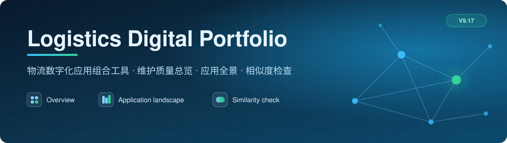
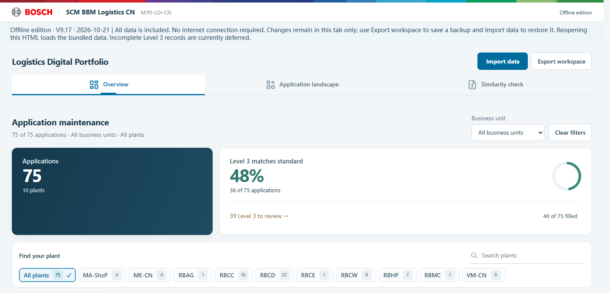
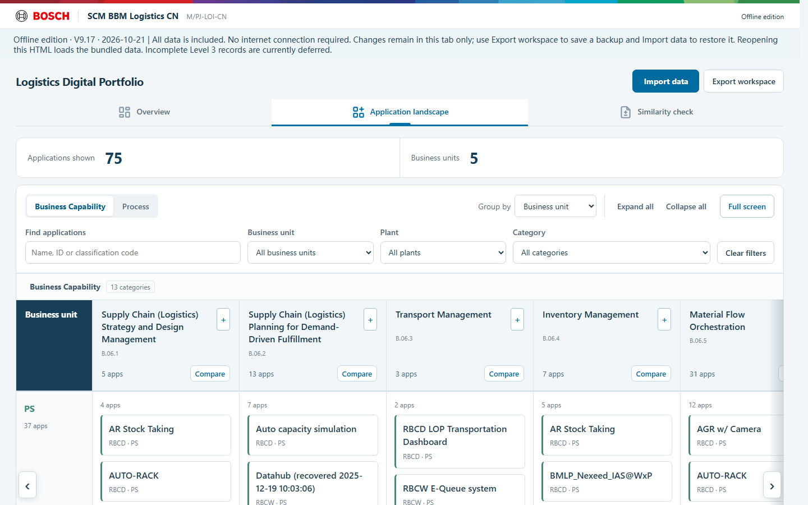
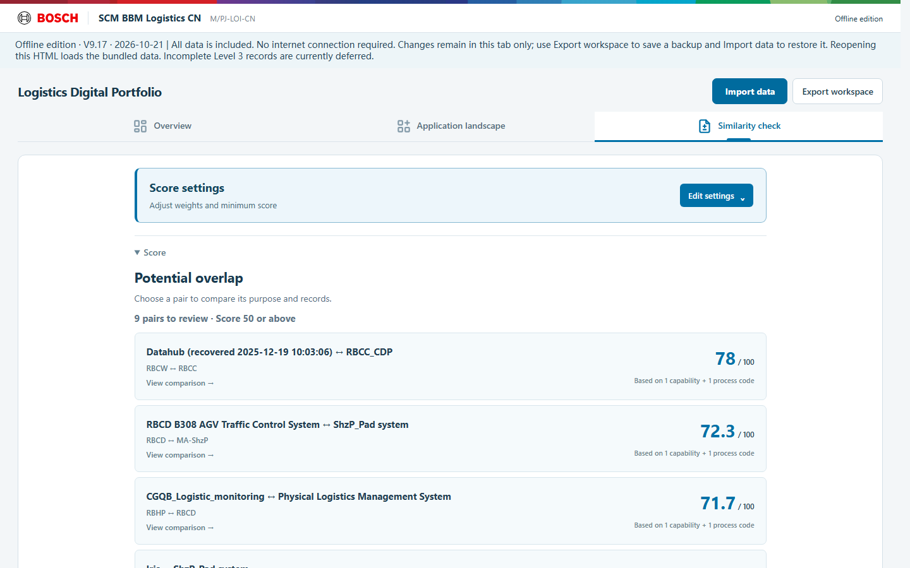
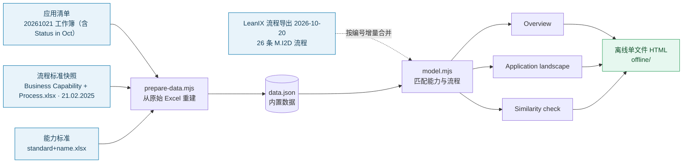

<p align="center"></p>

<p align="center">
  <a href="https://github.com/2113326213-design/logistics-digital-portfolio/releases/latest"></a>
  <a href="http://wx-web-td02.apac.bosch.com:8083"></a>
  <a href="#我想"></a>
  <a href="CHANGELOG.md"></a>
  <a href="https://github.com/2113326213-design/logistics-digital-portfolio/issues/new/choose"></a>
</p>

<h3 align="center">一个页面看清整个物流应用组合</h3>

<p align="center">
  <b>哪些应用登记不全</b> &nbsp;·&nbsp; <b>谁在做什么</b> &nbsp;·&nbsp; <b>哪些可能重复</b><br>
  <sub>离线单文件 · 不需要安装 · 用 Chrome 打开即用 · 页面界面为英文</sub>
</p>

<p align="center">
  &nbsp;
  &nbsp;
  &nbsp;
  &nbsp;
  
</p>

<hr>

<p align="center"></p>

> [!IMPORTANT]
> 本仓库包含真实的应用清单数据，请保持**私有**，不要把链接或文件转发给 Bosch 以外的人。

## 打开工具

<table>
<tr>
<td width="50%" valign="top">

### 🌐 在线版（推荐）

在 Bosch 内网用 Chrome 直接打开：

**<http://wx-web-td02.apac.bosch.com:8083>**

- 用 **http**，不是 https。
- `td02` 里是数字 **0**，不是字母 o。
- 打不开时试 `http://10.8.186.214:8083`；仍打不开就用右边的离线版，并告诉维护人。

</td>
<td width="50%" valign="top">

### 💾 离线版

不在内网，或想自己保留一份时用：

1. 下载 [**logistics-offline-20261021-v9.17.zip**](https://github.com/2113326213-design/logistics-digital-portfolio/releases/latest)。
2. 右键 → **Extract all**。
3. 用 Chrome 打开里面的 HTML。

页面顶部显示 **V9.17** 就对了。

</td>
</tr>
</table>

<table align="center">
  <tr>
    <td align="center" width="25%"><h3>75</h3><sub>应用 · 10 个工厂 · 5 个业务部门</sub></td>
    <td align="center" width="25%"><h3>2,775</h3><sub>组两两比较 · 9 组得分 ≥ 50</sub></td>
    <td align="center" width="25%"><h3>23 / 39</h3><sub>Process / Capability 待处理应用</sub></td>
    <td align="center" width="25%"><h3>V9.17</h3><sub>2026-10-21 · 459 项测试通过</sub></td>
  </tr>
</table>

## 三个页面

| 页面 | 回答什么问题 | 怎么用 |
|---|---|---|
| 📊 **Overview** | 哪些应用登记得不完整？ | 按工厂看 Business Capability 和 Process 各层级的**填写率**、**标准匹配率**。**To review** 列出要处理的应用，点 **View details** 看是哪条记录、下一步确认什么。 |
| 🗺️ **Application landscape** | 谁在做什么？ | 全部应用按业务能力或流程分类排列。分类旁的 **+** 逐级展开，**Category** 下拉按 Level 0–3 分组，编号与原始 Excel 一致。 |
| 🔍 **Similarity check** | 哪些应用可能重复？ | 按名称、描述、能力、流程四项加权打分。顶部 **Score settings** 调权重和最低分；资料不全的应用在 **Check application records** 里按应用列出。 |

<table>
<tr>
<td width="50%"><p align="center"><sub>Application landscape · 逐级展开</sub></p></td>
<td width="50%"><p align="center"><sub>Similarity check · 潜在重叠列表</sub></p></td>
</tr>
</table>

## 我想……

| 我想 | 去哪里 | 点什么 |
|---|---|---|
| 看我们工厂哪些应用要补登记 | **Overview** | 选工厂 → **To review** → 应用的 **View details** |
| 知道某条记录具体错在哪、该怎么改 | 应用详情 | **View details** 里每个问题都写了来源记录、对照的目录版本和下一步 |
| 看某个业务能力或流程下有哪些应用 | **Application landscape** | **Category** 下拉选层级，点分类旁的 **+** 展开 |
| 找可能重复的应用 | **Similarity check** | 看候选列表，点一组进入完整比较 |
| 拿一个应用和其他应用比 | **Similarity check** | **Compare an application** → 选第一个应用 → **Choose another application** |
| 一次比较多个应用 | **Similarity check** | **Compare multiple applications**，勾选要比的应用 |
| 调整打分标准 | **Similarity check** 顶部 | **Score settings** → **Edit settings**，改权重和 **Minimum score** |
| 保存我的调整，下次接着用 | 任意页面 | **Export workspace** 导出备份；下次用 **Import data** 恢复 |

## 常见问题

<details>
<summary><b>我在页面里改的东西会保存吗？</b></summary>
<br>
只保存在当前浏览器标签页里，关掉就没了。要保留，请用 <b>Export workspace</b> 导出备份文件，下次用 <b>Import data</b> 导入；备份里包含 Score settings 的权重和最低分。在线版也一样：修改只在你自己的浏览器里，别人看不到，也不会改到服务器上的内容。
</details>

<details>
<summary><b>相似度分数高，是不是就代表两个应用重复？</b></summary>
<br>
不是。分数只来自文字和分类编号的重合，用来找线索。要对照两个应用的描述和实际用途，并和负责人确认，才能判断是否真的重复。
</details>

<details>
<summary><b>发现数据错了，在工具里改吗？</b></summary>
<br>
不在工具里改。工具只读原始记录，不会改动 LeanIX 或任何业务数据。请确认后在 LeanIX 里修改，下一版工具会带上新数据。
</details>

<details>
<summary><b>数据有多新？</b></summary>
<br>
应用清单来自 2026-10-21 的自有工作簿（<code>20261021_logistic_inventory.xlsx</code> 的 Logistic Apps_1021，含 Status in Oct；不是 still active 的应用和 no score 的应用不计入成本、ROI 和相似度检查），此前依次并入了 2026-08-25 的清单和 2026-10-20 的 LeanIX 应用导出；流程标准以 2025-02-21 的快照为准，并按编号合并了 2026-10-20 的 LeanIX 流程导出（新旧名称并列保留，有差异的标为待确认）。
</details>

<details>
<summary><b>在线版打不开怎么办？</b></summary>
<br>
<ol>
<li>确认地址是 <code>http://</code>（不是 https），<code>td02</code> 里是数字 0。浏览器自动改成 https 时，手动删掉 s 再回车。</li>
<li>换成 IP 试：<code>http://10.8.186.214:8083</code>。</li>
<li>提示找不到地址（<code>ERR_NAME_NOT_RESOLVED</code>）多半是拼写错误；一直转圈后超时（<code>ERR_CONNECTION_TIMED_OUT</code>）多半是网络或防火墙，请告诉维护人。</li>
<li>先用离线版继续工作。</li>
</ol>
</details>

<details>
<summary><b>页面打开了，但不是 V9.17，或者显示不全？</b></summary>
<br>
按 <b>Ctrl + F5</b> 强制刷新（浏览器可能缓存了旧版本）。工具在 Chrome 上测试过，请优先用 Chrome。
</details>

<details>
<summary><b>发现问题或想提需求，找谁？</b></summary>
<br>
在本仓库 <a href="https://github.com/2113326213-design/logistics-digital-portfolio/issues/new/choose">新建 Issue</a>，选“提需求 / 修改建议”或“报告问题”，按表格填写页面、步骤和期望结果即可。
</details>

## 主要规则

| 规则 | 含义 |
|---|---|
| **不自动改数据** | 程序只读原始记录；LeanIX 和业务数据的修改都要人工确认。 |
| **层级覆盖** | Level 3 已正确登记、能找到标准上级时，上级未单独登记不再算问题（Capability Level 2；Process Level 0–2）。"filled" 仍只统计直接登记。 |
| **相似度只是线索** | 分数来自文字和分类编号的重合，不代表业务功能确认重复。 |
| **流程来源可追溯** | 流程标准以 21.02.2025 的快照为准，2026-10-20 的 LeanIX 导出按编号合并进来，新旧名称并列保留，差异标为待确认。 |

## 版本记录

完整更新日志见 [`CHANGELOG.md`](CHANGELOG.md)。

**V9.17（当前，2026-10-21）**：并入 2026-10-21 的自有工作簿（Logistic Apps_1021，新增 Status in Oct）：Status 不是 still active 的 3 个应用和 no score 的 5 个一样不计入成本、ROI 和相似度检查；CGQB_Logistic_system_Q 不在新清单里，已移出；14 个成本分、9 个 ROI 分按新的 Parameter Score 更新；ROI 继续按公式显示回本时间。

**V9.16（2026-10-21）**：并入 2026-10-20 的 LeanIX 应用导出（71 个应用，按 ID 更新 35 个；导出未包含的 5 个保留并在详情里标注）；Import data 可以直接读取 LeanIX 导出。

**V9.15（2026-10-20）**：单对比较按应用列出待核对记录并直达详情；切换页面时保留比较结果；阈值随备份导出、导入。

<details>
<summary><b>V9 系列全部版本</b></summary>
<br>

| 版本 | 主要变化 |
|---|---|
| [V9.17](https://github.com/2113326213-design/logistics-digital-portfolio/releases/tag/v9.17-20261021) | 并入 2026-10-21 的自有工作簿（Logistic Apps_1021，新增 Status in Oct）：Status 不是 still active 的 3 个应用和 no score 的 5 个一样不计入成本、ROI 和相似度检查；CGQB_Logistic_system_Q 不在新清单里，已移出；14 个成本分、9 个 ROI 分按新的 Parameter Score 更新；ROI 继续按公式显示回本时间；计入 67 个应用，年成本 ¥2,890,000；Capability To review 40 → 39 |
| [V9.16](https://github.com/2113326213-design/logistics-digital-portfolio/releases/tag/v9.16-20261021) | 并入 2026-10-20 的 LeanIX 应用导出（按 ID 更新 35 个应用；未包含的 5 个保留并标注）；Import data 接受 LeanIX 导出格式；Process To review 24 → 23，Capability 38 → 40 |
| [V9.15](https://github.com/2113326213-design/logistics-digital-portfolio/releases/tag/v9.15-20261020) | 单对比较按应用列出待核对记录并直达详情；切换页面保留比较；Deferred detail 移入计算说明；阈值随备份导出、导入，导出提示分状态 |
| [V9.14](https://github.com/2113326213-design/logistics-digital-portfolio/releases/tag/v9.14-20261020) | 已隐藏的其他比较结果不再在页面里生成（页面更轻）；关闭应用详情后焦点回到原入口 |
| [V9.13](https://github.com/2113326213-design/logistics-digital-portfolio/releases/tag/v9.13-20261020) | 单应用比较第二步改为按名称排列的 Choose another application |
| [V9.12](https://github.com/2113326213-design/logistics-digital-portfolio/releases/tag/v9.12-20261020) | 多应用比较给出下一步（Compare actual uses）；待核对资料按应用去重 |
| [V9.11](https://github.com/2113326213-design/logistics-digital-portfolio/releases/tag/v9.11-20261020) | 隐藏 "other comparison results and screening reasons" 入口 |
| [V9.10](https://github.com/2113326213-design/logistics-digital-portfolio/releases/tag/v9.10-20261020) | 其他比较结果默认收起 |
| [V9.9](https://github.com/2113326213-design/logistics-digital-portfolio/releases/tag/v9.9-20261020) | 受资料影响的 1,159 对比较归并为 19 个待核对应用 |
| [V9.8](https://github.com/2113326213-design/logistics-digital-portfolio/releases/tag/v9.8-20261020) | Score settings 移到 Similarity check 顶部 |
| [V9.7](https://github.com/2113326213-design/logistics-digital-portfolio/releases/tag/v9.7-20261020) | Overview 列表不再展开问题说明，点 View details 查看 |
| [V9.6](https://github.com/2113326213-design/logistics-digital-portfolio/releases/tag/v9.6-20261020) | 应用详情只显示待检查的问题 |
| [V9.5](https://github.com/2113326213-design/logistics-digital-portfolio/releases/tag/v9.5-20261020) | Process Level 0、Level 1 也由已确认的 Level 3 覆盖；Process To review 45 → 24 |
| [V9.4](https://github.com/2113326213-design/logistics-digital-portfolio/releases/tag/v9.4-20261020) | 能力全在 B.06 之外的应用，比较页改为 "Not compared · outside the B.06 scope" |
| [V9.3](https://github.com/2113326213-design/logistics-digital-portfolio/releases/tag/v9.3-20261020) | Category 下拉按 Level 0–3 分组排序 |
| [V9.2](https://github.com/2113326213-design/logistics-digital-portfolio/releases/tag/v9.2-20261020) | Process Level 2 覆盖规则；修复导入预览报错；统一状态标签 |
| [V9.1](https://github.com/2113326213-design/logistics-digital-portfolio/releases/tag/v9.1-20261020) | Capability Level 2 由已确认的 Level 3 覆盖 |
| [V9](https://github.com/2113326213-design/logistics-digital-portfolio/releases/tag/v9-20261020) | Similarity check 按步骤比较，返回时保留位置 |
| [V8](https://github.com/2113326213-design/logistics-digital-portfolio/releases/tag/v8-20261020) | 并入 LeanIX 流程导出；删除比较说明和 Your review 区域 |

更早的版本和每次改动的详细说明见 [`00_Claude先读.md`](00_Claude先读.md)；每个版本的验证记录在 [`verification/`](verification/)。

</details>

---

## 给维护者

以下内容给部署、更新和修改程序的人；使用工具不需要看。

<details>
<summary><b>🚀 部署 / 更新内网版（IIS，WX-WEB-TD02）</b></summary>
<br>

1. 在服务器的 Chrome 里（已登录 GitHub）下载 [**deploy-iis-script.zip**](https://github.com/2113326213-design/logistics-digital-portfolio/raw/main/offline/deploy-iis-script.zip) 和 [Releases 最新版](https://github.com/2113326213-design/logistics-digital-portfolio/releases/latest)里的 **logistics-offline-….zip**，都放在 `Downloads`。脚本每次发布都会按当前版本自动重新生成，两者要来自同一个版本；不一致时脚本会在校验这一步停下并写明需要哪个 zip。
2. 打开脚本 zip，双击 `deploy-iis.bat` → Security Warning 点 **Run** → UAC 点 **Yes**（脚本会自己申请管理员权限）。部署在新打开的管理员窗口里进行；第一个小窗口关闭是正常的。
3. 新窗口显示 `[6/6] OK` 和 `=== DONE ===` 即完成；窗口不会自动关闭，出错时会写明原因。如果没有出现新窗口，原窗口会写明原因并等待按键，这时把脚本 zip 解压到 `Downloads`，右键 `deploy-iis.bat` → **Run as administrator**。

> 2026-10-22 修复：脚本现在按完整路径调用 `appcmd`，任何情况下窗口都会停住并写明原因（之前在部分服务器上会“黑框消失”）。改脚本的规则见 [`00_Claude先读.md`](00_Claude先读.md) 的“部署脚本编写规则”，发布前运行 `npm run deploy:sim` 在本机模拟。

默认部署到 `D:\logistics-tool`、端口 `8083`、站点 `LogisticsTool`；换端口或目录：`deploy-iis.bat 8084 D:\其他目录`。站点已存在时只更新文件。

脚本会校验 HTML 的 SHA-256，把旧 `index.html` 备份到 `D:\logistics-tool_backup\`，按 SID 授予 IIS_IUSRS/IUSR 读取权限（这台服务器是域控，按名字找不到 IIS_IUSRS），只新建自己的站点，**不改防火墙和其他站点**。其他电脑访问不了时需要放行 8083 入站，须先经服务器负责人同意。源文件：[`offline/deploy-iis.bat`](offline/deploy-iis.bat)，由 `program/scripts/deploy-script.mjs` 按模板 `program/scripts/deploy-iis.template.bat` 自动生成（`npm run export:offline` 生成，`npm run release:files` 放进 `offline/`）。旧的 `deploy-iis-v9.15.bat` 只适用于 V9.15。

**回滚**：把 `D:\logistics-tool_backup\` 里的旧文件复制回 `D:\logistics-tool\index.html`。

</details>

<details>
<summary><b>🛠️ 修改程序</b></summary>
<br>

`program/` 是源码（原生 ES 模块，没有框架），需要 Node 22.13 或更新版本：

```
npm ci → npm test → npm run build → npm run export:offline
```

改完文件后用 `node .github/scripts/check-manifest.mjs --write` 重新生成 `MANIFEST.sha256`，用 `node .github/scripts/check-manifest.mjs` 核对。

接手前先读 [`00_Claude先读.md`](00_Claude先读.md)（中文，按日期记录每次改动和用户决定），再读 [`program/README.md`](program/README.md)（英文，"Current state" 一节是当前状态）。

</details>

<details>
<summary><b>🔄 数据从哪里来</b></summary>
<br>



原始记录只读，程序不会自动改动 LeanIX 或业务数据；所有修正都要人工确认后在 LeanIX 里改。

</details>

<details>
<summary><b>🗂️ 文件地图（给 AI 助手和新接手的人）</b></summary>
<br>

所有路径都相对于仓库根目录，页面逻辑都在 `program/public/`。在 GitHub 上的地址是 `https://github.com/2113326213-design/logistics-digital-portfolio/blob/main/<路径>`。

| 想找什么 | 在哪里 |
|---|---|
| 当前状态、改动记录、用户决定 | `00_Claude先读.md`、`program/README.md` |
| 内置数据（75 个应用、能力和流程目录） | `program/public/data.json`（2026-10-21 自有工作簿 Logistic Apps_1021，经 Import data 同一路径合并；`statusNote` 记录 Status in Oct）；`program/scripts/prepare-data.mjs` 只能重建 8 月格式的工作簿（不读 Status 列），可从原始 Excel 重建 |
| LeanIX 流程导出（2026-10-20，26 条） | `program/public/leanix-process-export.mjs`（原样数据）、`program/public/leanix-processes.mjs`（按编号合并、名称差异、来源） |
| 数据模型：读入应用、匹配能力和流程 | `program/public/model.mjs`、`program/public/codes.mjs` |
| 页面入口和整体渲染 | `program/public/index.html`、`program/public/app.js` |
| Overview：各层级统计、To review、上级由三级确认的规则 | `program/public/overview.mjs`、`program/public/review-issues.mjs`（`capabilityLevel2Coverage`、`processAncestorCoverage`） |
| 应用详情：问题列表、源记录 | `program/public/process-issues.mjs`（`focusApplicationIssue` 定位问题）、`program/public/source-records.mjs`、`program/public/app.js` |
| Application landscape：分类列、逐级展开、Excel 编号、Category 下拉（按层级排序） | `program/public/landscape.mjs`（`categoryOptions`）、`program/public/model.mjs`（`columns`） |
| Similarity check：评分 | `program/public/weighted.mjs`、`program/public/similarity.mjs`、`program/public/score-values.mjs` |
| Similarity check：页面、状态、证据 | `program/public/similarity-ui.mjs`、`program/public/similarity-readiness.mjs`（按应用归并待检查记录）、`program/public/pair-status.mjs`、`program/public/comparison-records.mjs`、`program/public/weight-controls.mjs` |
| 已保存的组合评审数据 | `program/public/similarity-guide.mjs`（`cleanPairReviews`）、`program/public/workspace.mjs` |
| ROI 回本时间、年度成本 | `program/public/roi.mjs`、`program/public/costs.mjs` |
| 导入 / 导出（Excel、工作区、CSV） | `program/public/xlsx.mjs`、`program/public/import-review.mjs`、`program/public/workspace.mjs`、`program/public/exports.mjs`、`program/public/score-settings.mjs`（阈值随备份）、`program/public/offline-save.mjs`（离线导出提示） |
| 样式 | `program/public/*.css` |
| 构建和离线单文件 | `program/scripts/build.mjs`、`program/scripts/export-offline.mjs` |
| 测试（`npm test`，当前 459 项） | `program/tests/*.test.mjs`；最近一次完整结果在 `verification/v9.17-test-results.txt` |
| 离线单文件版 | `offline/` |
| IIS 部署脚本（每次发布自动生成） | `offline/deploy-iis.bat`（打包下载版 `offline/deploy-iis-script.zip`）；生成器 `program/scripts/deploy-script.mjs`，模板 `program/scripts/deploy-iis.template.bat`，发布打包 `program/scripts/release-files.mjs`（`npm run release:files`），检查 `program/tests/deploy-script.test.mjs`，本机模拟 `program/scripts/deploy-sim.mjs`（`npm run deploy:sim`） |
| 构建输出、文件校验清单 | `built/`、`MANIFEST.sha256` |
| README 横幅、按钮、徽章和截图 | `docs/images/`；按钮 `button-*.svg` 和徽章 `badge-*.svg` 由 `program/scripts/readme-art.mjs`（`npm run readme:art`）按测试日志和内置数据生成；截图 `screen-*.png` 是离线页面 1440×900 的实拍 |
| 更新日志、许可、安全说明 | [`CHANGELOG.md`](CHANGELOG.md)、[`LICENSE`](LICENSE)（内部使用）、[`SECURITY.md`](SECURITY.md) |

</details>

<br>

<p align="center"><sub>Logistics Digital Portfolio · 2026 · 离线、只读、可追溯<br><a href="CHANGELOG.md">更新日志</a> · <a href="SECURITY.md">安全说明</a> · <a href="LICENSE">内部使用许可</a> · <a href="https://github.com/2113326213-design/logistics-digital-portfolio/releases/latest">下载最新版</a></sub></p>
