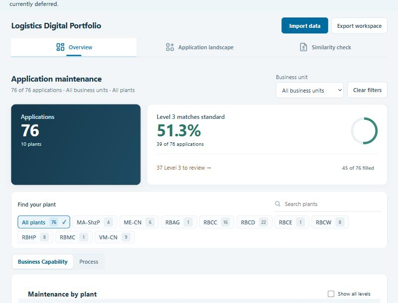
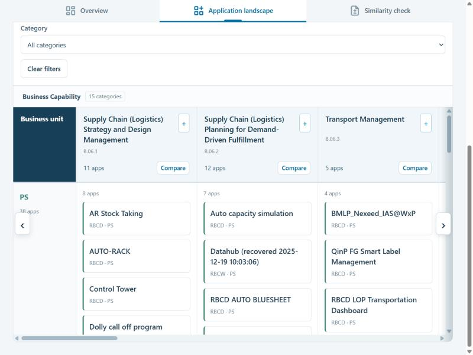
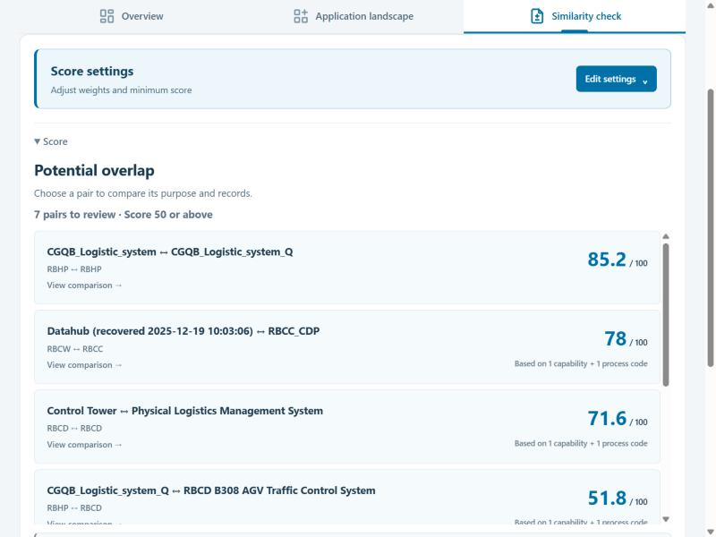

# Logistics Digital Portfolio

**物流数字化应用组合工具**：维护质量总览 · 应用全景 · 相似度检查

当前版本 **V9.14（2026-10-20）** · 76 个应用 · 10 个工厂 · 离线单文件，双击即用

[**⬇ 下载最新版**](https://github.com/2113326213-design/logistics-digital-portfolio/releases/latest) &nbsp;·&nbsp; [版本记录](#版本记录) &nbsp;·&nbsp; [接手说明](00_Claude先读.md) &nbsp;·&nbsp; [文件地图](#文件地图给-ai-助手和新接手的人)

> [!IMPORTANT]
> 本仓库包含真实的应用清单数据，请保持**私有**，不要转发下载链接给外部人员。

## 三个页面

| 页面 | 用来做什么 |
|---|---|
| **Overview** | 按工厂查看 Business Capability 和 Process 各层级的填写与标准匹配情况。**To review** 列出需要处理的应用，点 **View details** 看具体原因、核对来源和下一步。 |
| **Application landscape** | 按业务能力或流程分类排列全部应用。分类旁的 **+** 逐级展开；**Category** 下拉按 Level 0–3 分组，编号与原始 Excel 一致。 |
| **Similarity check** | 按名称、描述、能力、流程四项加权，找可能重叠的应用。顶部 **Score settings** 调整权重和最低分；资料待核对的应用在 **Check application records** 中按应用列出。 |

<table>
<tr>
<td width="50%">
Application landscape
</td>
<td width="50%">
Similarity check
</td>
</tr>
</table>

## 快速开始

- **直接使用**：下载 [V9.14 离线包](offline/logistics-offline-20261020-v9.14.zip)，或到本仓库 [Releases](https://github.com/2113326213-design/logistics-digital-portfolio/releases/latest) 下载同名文件，解压后用 Chrome 打开 `物流工具_最新版_离线单文件_20261020_v9.14.html`，不需要联网。页面顶部会显示 V9.14。
- **保存修改**：页面里的修改只保存在当前标签页。用 **Export workspace** 导出备份，下次用 **Import data** 恢复。
- **交接说明**：先读 [`00_Claude先读.md`](00_Claude先读.md)（中文，按日期记录每次改动和用户决定），再读 [`program/README.md`](program/README.md)（英文，"Current state" 一节是当前状态）。
- **程序源码**：`program/`（`npm ci`、`npm test`、`npm run build`、`npm run export:offline`，需要 Node 22.13 或更新版本）。

## 主要规则

- **不自动改数据**：程序只读原始记录，不会自动修改 LeanIX 或业务数据；所有修正都要人工确认。
- **层级覆盖**：Level 3 已正确登记、能找到标准上级时，上级未单独登记不再算问题（Capability Level 2；Process Level 0–2）。“filled” 仍只统计直接登记。
- **相似度只是线索**：分数来自文字和分类编号的重合，不代表业务功能确认重复；需要对照描述和负责人确认。
- **流程来源**：流程标准以 `Business Capability + Process.xlsx`（21.02.2025 快照）为准，并按编号合并 2026-10-20 的 LeanIX 导出（26 条 M.I2D 流程）。

## 版本记录

| 版本 | 主要变化 |
|---|---|
| [V9.14](https://github.com/2113326213-design/logistics-digital-portfolio/releases/tag/v9.14-20261020) | 已隐藏的其他比较结果不再在页面里生成（页面更轻）；关闭应用详情后焦点回到原入口 |
| [V9.13](https://github.com/2113326213-design/logistics-digital-portfolio/releases/tag/v9.13-20261020) | 单应用比较第二步改为按名称排列的 Choose another application |
| [V9.12](https://github.com/2113326213-design/logistics-digital-portfolio/releases/tag/v9.12-20261020) | 多应用比较给出下一步（Compare actual uses）；待核对资料按应用去重 |
| [V9.11](https://github.com/2113326213-design/logistics-digital-portfolio/releases/tag/v9.11-20261020) | 隐藏 “other comparison results and screening reasons” 入口 |
| [V9.10](https://github.com/2113326213-design/logistics-digital-portfolio/releases/tag/v9.10-20261020) | 其他比较结果默认收起 |
| [V9.9](https://github.com/2113326213-design/logistics-digital-portfolio/releases/tag/v9.9-20261020) | 受资料影响的 1,159 对比较归并为 19 个待核对应用 |
| [V9.8](https://github.com/2113326213-design/logistics-digital-portfolio/releases/tag/v9.8-20261020) | Score settings 移到 Similarity check 顶部 |
| [V9.7](https://github.com/2113326213-design/logistics-digital-portfolio/releases/tag/v9.7-20261020) | Overview 列表不再展开问题说明，点 View details 查看 |
| [V9.6](https://github.com/2113326213-design/logistics-digital-portfolio/releases/tag/v9.6-20261020) | 应用详情只显示待检查的问题 |
| [V9.5](https://github.com/2113326213-design/logistics-digital-portfolio/releases/tag/v9.5-20261020) | Process Level 0、Level 1 也由已确认的 Level 3 覆盖；Process To review 45 → 24 |
| [V9.4](https://github.com/2113326213-design/logistics-digital-portfolio/releases/tag/v9.4-20261020) | 能力全在 B.06 之外的应用，比较页改为 “Not compared · outside the B.06 scope” |
| [V9.3](https://github.com/2113326213-design/logistics-digital-portfolio/releases/tag/v9.3-20261020) | Category 下拉按 Level 0–3 分组排序 |
| [V9.2](https://github.com/2113326213-design/logistics-digital-portfolio/releases/tag/v9.2-20261020) | Process Level 2 覆盖规则；修复导入预览报错；统一状态标签 |
| [V9.1](https://github.com/2113326213-design/logistics-digital-portfolio/releases/tag/v9.1-20261020) | Capability Level 2 由已确认的 Level 3 覆盖 |
| [V9](https://github.com/2113326213-design/logistics-digital-portfolio/releases/tag/v9-20261020) | Similarity check 按步骤比较，返回时保留位置 |
| [V8](https://github.com/2113326213-design/logistics-digital-portfolio/releases/tag/v8-20261020) | 并入 LeanIX 流程导出；删除比较说明和 Your review 区域 |

更早的版本和每次改动的详细说明见 [`00_Claude先读.md`](00_Claude先读.md)；每个版本的验证记录在 [`verification/`](verification/)。

## 文件地图（给 AI 助手和新接手的人）

所有路径都相对于仓库根目录，在 GitHub 上的地址是 `https://github.com/2113326213-design/logistics-digital-portfolio/blob/main/<路径>`。程序是不需要框架的 ES 模块，页面逻辑都在 `program/public/`。

| 想找什么 | 在哪里 |
|---|---|
| 当前状态、改动记录、用户决定 | `00_Claude先读.md`、`program/README.md` |
| 内置数据（76 个应用、能力和流程目录） | `program/public/data.json`；由 `program/scripts/prepare-data.mjs` 从原始 Excel 重建 |
| LeanIX 流程导出（2026-10-20，26 条） | `program/public/leanix-process-export.mjs`（原样数据）、`program/public/leanix-processes.mjs`（按编号合并、名称差异、来源） |
| 数据模型：读入应用、匹配能力和流程 | `program/public/model.mjs`、`program/public/codes.mjs` |
| 页面入口和整体渲染 | `program/public/index.html`、`program/public/app.js` |
| Overview：各层级统计、To review、上级由三级确认的规则 | `program/public/overview.mjs`、`program/public/review-issues.mjs`（`capabilityLevel2Coverage`、`processAncestorCoverage`） |
| 应用详情：问题列表、源记录 | `program/public/process-issues.mjs`、`program/public/source-records.mjs`、`program/public/app.js` |
| Application landscape：分类列、逐级展开、Excel 编号、Category 下拉（按层级排序） | `program/public/landscape.mjs`（`categoryOptions`）、`program/public/model.mjs`（`columns`） |
| Similarity check：评分 | `program/public/weighted.mjs`、`program/public/similarity.mjs`、`program/public/score-values.mjs` |
| Similarity check：页面、状态、证据 | `program/public/similarity-ui.mjs`、`program/public/similarity-readiness.mjs`（按应用归并待检查记录）、`program/public/pair-status.mjs`、`program/public/comparison-records.mjs`、`program/public/weight-controls.mjs` |
| 已保存的组合评审数据 | `program/public/similarity-guide.mjs`（`cleanPairReviews`）、`program/public/workspace.mjs` |
| ROI 回本时间、年度成本 | `program/public/roi.mjs`、`program/public/costs.mjs` |
| 导入 / 导出（Excel、工作区、CSV） | `program/public/xlsx.mjs`、`program/public/import-review.mjs`、`program/public/workspace.mjs`、`program/public/exports.mjs` |
| 样式 | `program/public/*.css` |
| 构建和离线单文件 | `program/scripts/build.mjs`、`program/scripts/export-offline.mjs` |
| 测试（`npm test`，当前 409 项） | `program/tests/*.test.mjs`；最近一次完整结果在 `verification/v9.14-test-results.txt` |
| 离线单文件版 | `offline/` |
| README 截图 | `docs/images/` |
| 构建输出、文件校验清单 | `built/`、`MANIFEST.sha256` |
